# Employee Management System

**It's my third year ISD project.**

An Employee Management System interface designed in **Figma**, covering employee and administrator workflows.

## View the design

[Open the Employee Management System in Figma](https://www.figma.com/design/62z16EXydNLBMnICP3x61C/Employee-Management-System)

The editable design is maintained in Figma. This repository presents the design project and exported screen previews; it does not contain a working application.

## Design scope

- User registration and login screens
- Employee dashboard and profile updates
- Administrator dashboard and employee management
- Leave applications, confirmation, and recall

## Figures

The Figma file contains **25 screen frames**. All are linked below; **14 exported previews** are included. The other 11 previews are pending because Figma's Starter-plan MCP export limit was reached.

| Figure | Screen | Design | Preview |
| --- | --- | --- | --- |
| 1 | User registration | [Open in Figma](https://www.figma.com/design/62z16EXydNLBMnICP3x61C/Employee-Management-System?node-id=33-1665) | [View image](assets/figure-01.png) |
| 2 | User login | [Open in Figma](https://www.figma.com/design/62z16EXydNLBMnICP3x61C/Employee-Management-System?node-id=33-1666) | [View image](assets/user-login.png) |
| 3 | Employee dashboard | [Open in Figma](https://www.figma.com/design/62z16EXydNLBMnICP3x61C/Employee-Management-System?node-id=34-1903) | [View image](assets/figure-03.png) |
| 4 | Leave application overview | [Open in Figma](https://www.figma.com/design/62z16EXydNLBMnICP3x61C/Employee-Management-System?node-id=33-1663) | [View image](assets/figure-04.png) |
| 5 | Annual leave application form | [Open in Figma](https://www.figma.com/design/62z16EXydNLBMnICP3x61C/Employee-Management-System?node-id=33-1667) | [View image](assets/figure-05.png) |
| 6 | Leave application confirmation | [Open in Figma](https://www.figma.com/design/62z16EXydNLBMnICP3x61C/Employee-Management-System?node-id=33-1668) | [View image](assets/figure-06.png) |
| 7 | Leave recall | [Open in Figma](https://www.figma.com/design/62z16EXydNLBMnICP3x61C/Employee-Management-System?node-id=33-1670) | [View image](assets/figure-07.png) |
| 8 | Profile — personal details | [Open in Figma](https://www.figma.com/design/62z16EXydNLBMnICP3x61C/Employee-Management-System?node-id=37-9010) | [View image](assets/figure-08.png) |
| 9 | Frame 9 | [Open in Figma](https://www.figma.com/design/62z16EXydNLBMnICP3x61C/Employee-Management-System?node-id=37-9011) | Export pending |
| 10 | Frame 10 | [Open in Figma](https://www.figma.com/design/62z16EXydNLBMnICP3x61C/Employee-Management-System?node-id=37-9012) | Export pending |
| 11 | Profile — document uploads | [Open in Figma](https://www.figma.com/design/62z16EXydNLBMnICP3x61C/Employee-Management-System?node-id=37-9013) | [View image](assets/figure-11.png) |
| 12 | Profile — financial details | [Open in Figma](https://www.figma.com/design/62z16EXydNLBMnICP3x61C/Employee-Management-System?node-id=37-9014) | [View image](assets/figure-12.png) |
| 13 | Frame 13 | [Open in Figma](https://www.figma.com/design/62z16EXydNLBMnICP3x61C/Employee-Management-System?node-id=41-422) | Export pending |
| 14 | Admin — employee personal details | [Open in Figma](https://www.figma.com/design/62z16EXydNLBMnICP3x61C/Employee-Management-System?node-id=41-423) | [View image](assets/figure-14.png) |
| 15 | Frame 15 | [Open in Figma](https://www.figma.com/design/62z16EXydNLBMnICP3x61C/Employee-Management-System?node-id=41-424) | Export pending |
| 16 | Admin — employee educational qualifications | [Open in Figma](https://www.figma.com/design/62z16EXydNLBMnICP3x61C/Employee-Management-System?node-id=41-425) | [View image](assets/figure-16.png) |
| 17 | Admin — employee documents | [Open in Figma](https://www.figma.com/design/62z16EXydNLBMnICP3x61C/Employee-Management-System?node-id=41-426) | [View image](assets/figure-17.png) |
| 18 | Frame 18 | [Open in Figma](https://www.figma.com/design/62z16EXydNLBMnICP3x61C/Employee-Management-System?node-id=41-427) | Export pending |
| 19 | Frame 19 | [Open in Figma](https://www.figma.com/design/62z16EXydNLBMnICP3x61C/Employee-Management-System?node-id=41-428) | Export pending |
| 20 | Frame 20 | [Open in Figma](https://www.figma.com/design/62z16EXydNLBMnICP3x61C/Employee-Management-System?node-id=41-429) | Export pending |
| 21 | Frame 21 | [Open in Figma](https://www.figma.com/design/62z16EXydNLBMnICP3x61C/Employee-Management-System?node-id=41-430) | Export pending |
| 22 | Frame 22 | [Open in Figma](https://www.figma.com/design/62z16EXydNLBMnICP3x61C/Employee-Management-System?node-id=41-431) | Export pending |
| 23 | Administrator dashboard | [Open in Figma](https://www.figma.com/design/62z16EXydNLBMnICP3x61C/Employee-Management-System?node-id=41-432) | [View image](assets/admin-dashboard.png) |
| 24 | 21 new-01 (1) 1 | [Open in Figma](https://www.figma.com/design/62z16EXydNLBMnICP3x61C/Employee-Management-System?node-id=41-97) | Export pending |
| 25 | login-01 1 | [Open in Figma](https://www.figma.com/design/62z16EXydNLBMnICP3x61C/Employee-Management-System?node-id=41-13) | Export pending |

## Screen gallery

### Figure 1 — User registration

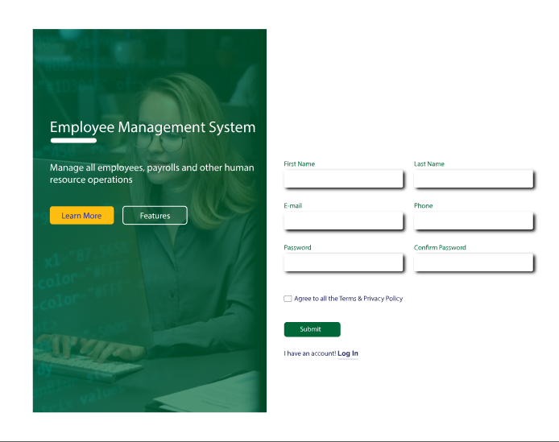

[View this figure in Figma](https://www.figma.com/design/62z16EXydNLBMnICP3x61C/Employee-Management-System?node-id=33-1665)

### Figure 2 — User login

[View this figure in Figma](https://www.figma.com/design/62z16EXydNLBMnICP3x61C/Employee-Management-System?node-id=33-1666)

### Figure 3 — Employee dashboard

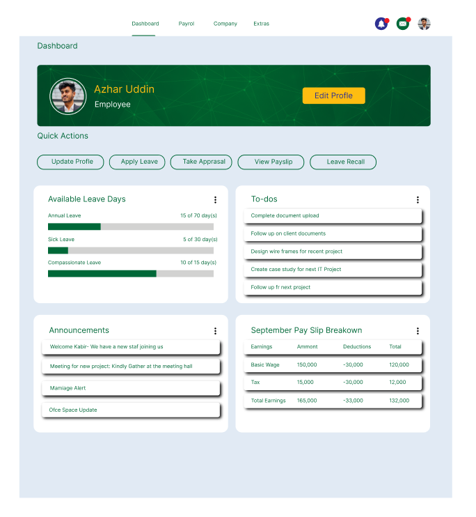

[View this figure in Figma](https://www.figma.com/design/62z16EXydNLBMnICP3x61C/Employee-Management-System?node-id=34-1903)

### Figure 4 — Leave application overview

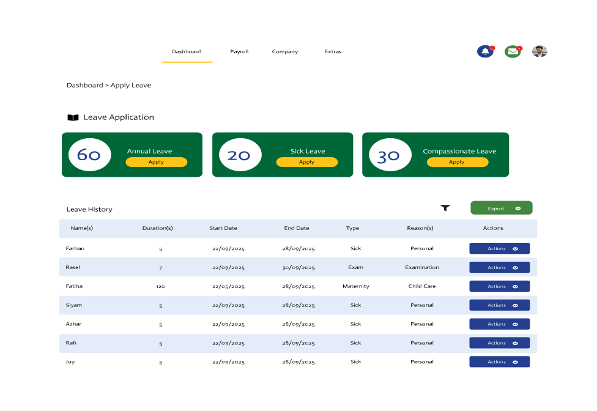

[View this figure in Figma](https://www.figma.com/design/62z16EXydNLBMnICP3x61C/Employee-Management-System?node-id=33-1663)

### Figure 5 — Annual leave application form

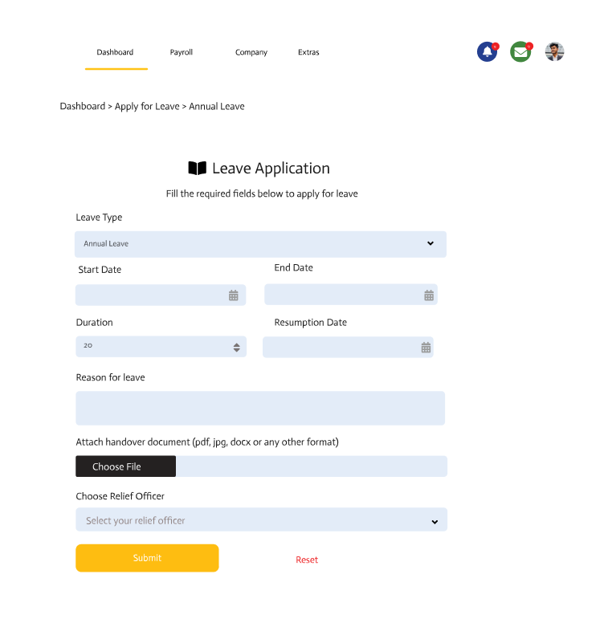

[View this figure in Figma](https://www.figma.com/design/62z16EXydNLBMnICP3x61C/Employee-Management-System?node-id=33-1667)

### Figure 6 — Leave application confirmation

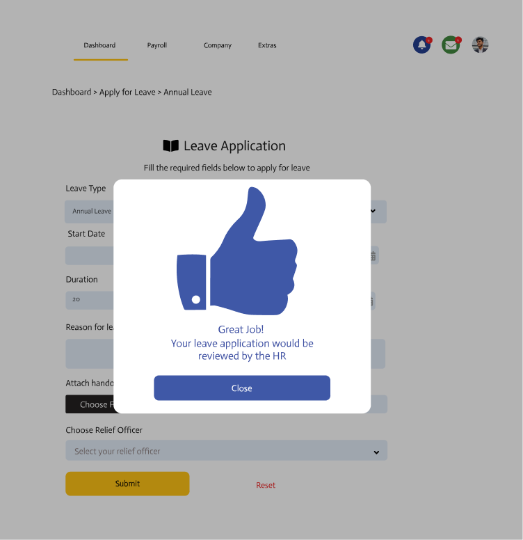

[View this figure in Figma](https://www.figma.com/design/62z16EXydNLBMnICP3x61C/Employee-Management-System?node-id=33-1668)

### Figure 7 — Leave recall

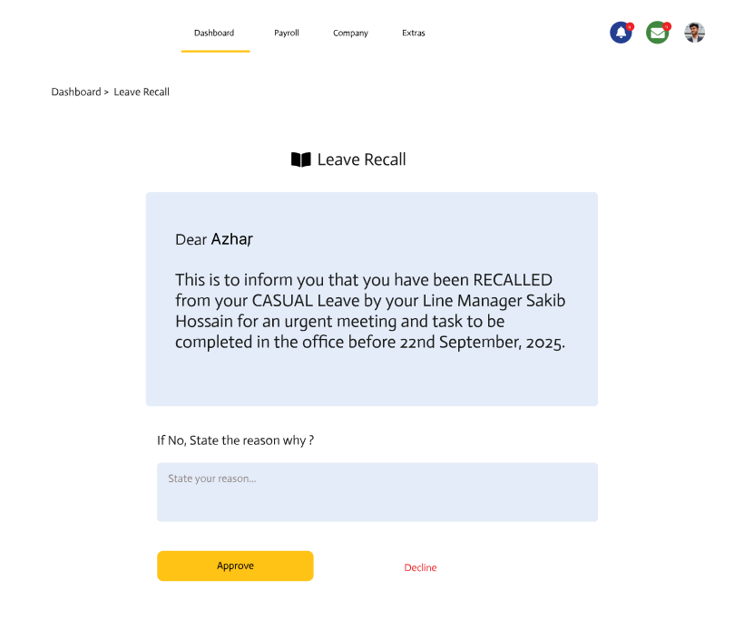

[View this figure in Figma](https://www.figma.com/design/62z16EXydNLBMnICP3x61C/Employee-Management-System?node-id=33-1670)

### Figure 8 — Profile — personal details

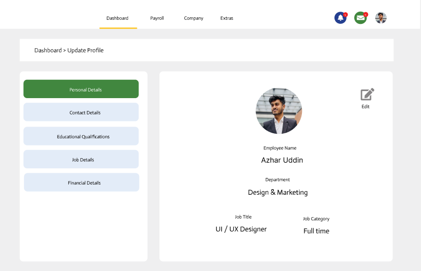

[View this figure in Figma](https://www.figma.com/design/62z16EXydNLBMnICP3x61C/Employee-Management-System?node-id=37-9010)

### Figure 9 — Frame 9

Preview export pending. Open the Figma screen using the link below.

[View this figure in Figma](https://www.figma.com/design/62z16EXydNLBMnICP3x61C/Employee-Management-System?node-id=37-9011)

### Figure 10 — Frame 10

Preview export pending. Open the Figma screen using the link below.

[View this figure in Figma](https://www.figma.com/design/62z16EXydNLBMnICP3x61C/Employee-Management-System?node-id=37-9012)

### Figure 11 — Profile — document uploads

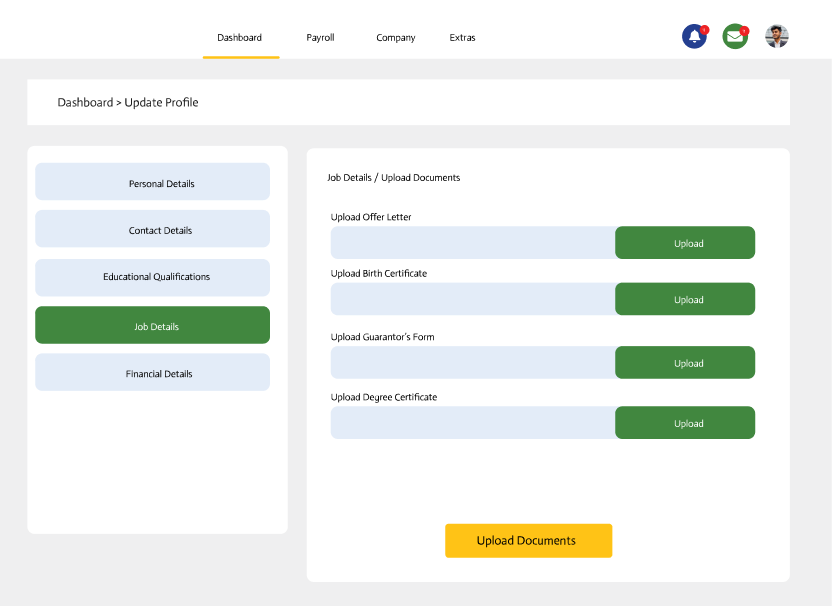

[View this figure in Figma](https://www.figma.com/design/62z16EXydNLBMnICP3x61C/Employee-Management-System?node-id=37-9013)

### Figure 12 — Profile — financial details

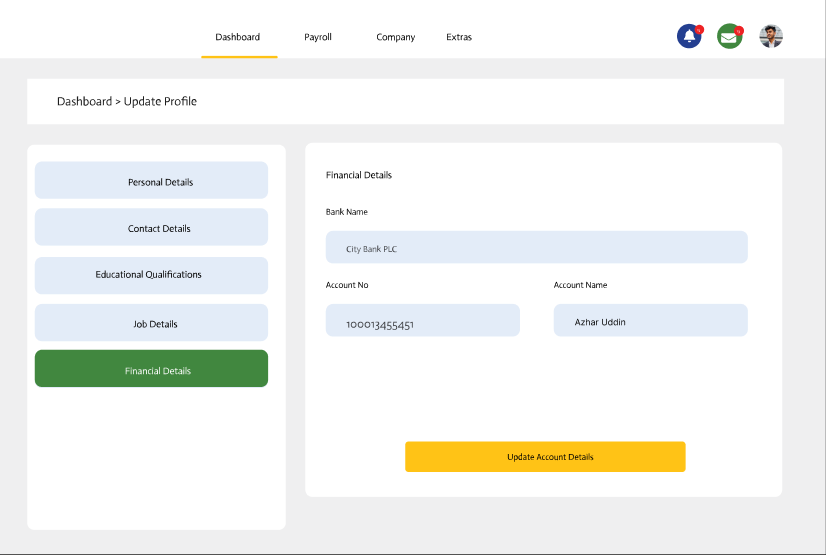

[View this figure in Figma](https://www.figma.com/design/62z16EXydNLBMnICP3x61C/Employee-Management-System?node-id=37-9014)

### Figure 13 — Frame 13

Preview export pending. Open the Figma screen using the link below.

[View this figure in Figma](https://www.figma.com/design/62z16EXydNLBMnICP3x61C/Employee-Management-System?node-id=41-422)

### Figure 14 — Admin — employee personal details

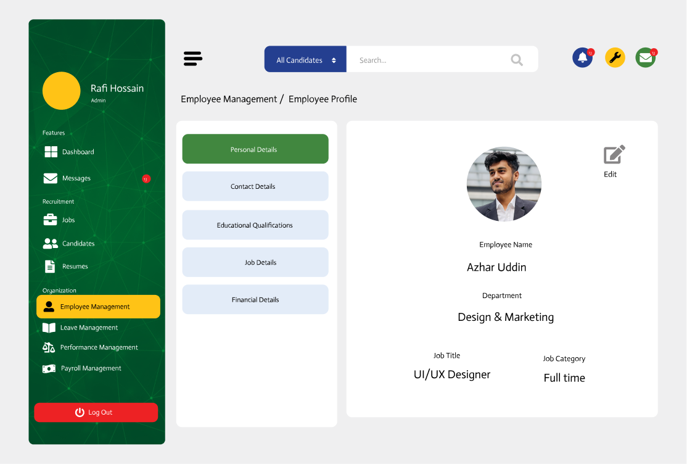

[View this figure in Figma](https://www.figma.com/design/62z16EXydNLBMnICP3x61C/Employee-Management-System?node-id=41-423)

### Figure 15 — Frame 15

Preview export pending. Open the Figma screen using the link below.

[View this figure in Figma](https://www.figma.com/design/62z16EXydNLBMnICP3x61C/Employee-Management-System?node-id=41-424)

### Figure 16 — Admin — employee educational qualifications

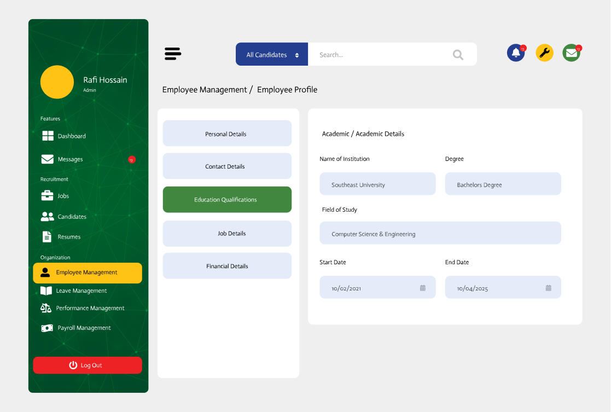

[View this figure in Figma](https://www.figma.com/design/62z16EXydNLBMnICP3x61C/Employee-Management-System?node-id=41-425)

### Figure 17 — Admin — employee documents

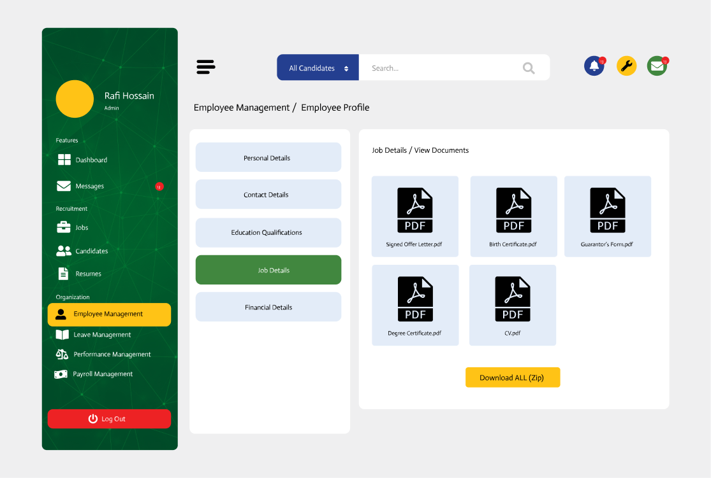

[View this figure in Figma](https://www.figma.com/design/62z16EXydNLBMnICP3x61C/Employee-Management-System?node-id=41-426)

### Figure 18 — Frame 18

Preview export pending. Open the Figma screen using the link below.

[View this figure in Figma](https://www.figma.com/design/62z16EXydNLBMnICP3x61C/Employee-Management-System?node-id=41-427)

### Figure 19 — Frame 19

Preview export pending. Open the Figma screen using the link below.

[View this figure in Figma](https://www.figma.com/design/62z16EXydNLBMnICP3x61C/Employee-Management-System?node-id=41-428)

### Figure 20 — Frame 20

Preview export pending. Open the Figma screen using the link below.

[View this figure in Figma](https://www.figma.com/design/62z16EXydNLBMnICP3x61C/Employee-Management-System?node-id=41-429)

### Figure 21 — Frame 21

Preview export pending. Open the Figma screen using the link below.

[View this figure in Figma](https://www.figma.com/design/62z16EXydNLBMnICP3x61C/Employee-Management-System?node-id=41-430)

### Figure 22 — Frame 22

Preview export pending. Open the Figma screen using the link below.

[View this figure in Figma](https://www.figma.com/design/62z16EXydNLBMnICP3x61C/Employee-Management-System?node-id=41-431)

### Figure 23 — Administrator dashboard

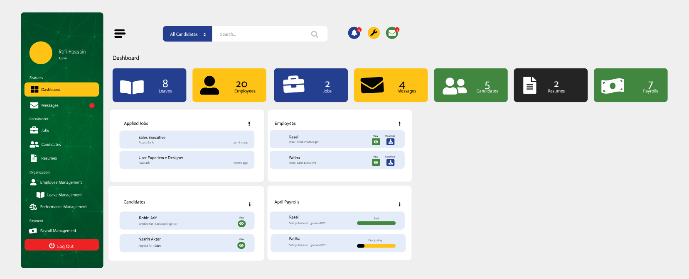

[View this figure in Figma](https://www.figma.com/design/62z16EXydNLBMnICP3x61C/Employee-Management-System?node-id=41-432)

### Figure 24 — 21 new-01 (1) 1

Preview export pending. Open the Figma screen using the link below.

[View this figure in Figma](https://www.figma.com/design/62z16EXydNLBMnICP3x61C/Employee-Management-System?node-id=41-97)

### Figure 25 — login-01 1

Preview export pending. Open the Figma screen using the link below.

[View this figure in Figma](https://www.figma.com/design/62z16EXydNLBMnICP3x61C/Employee-Management-System?node-id=41-13)

## Tools

- Figma for interface design
- PNG exports for the repository previews
